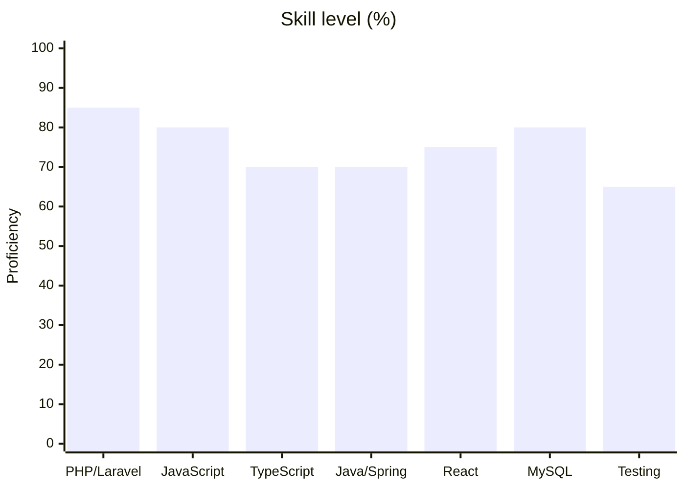
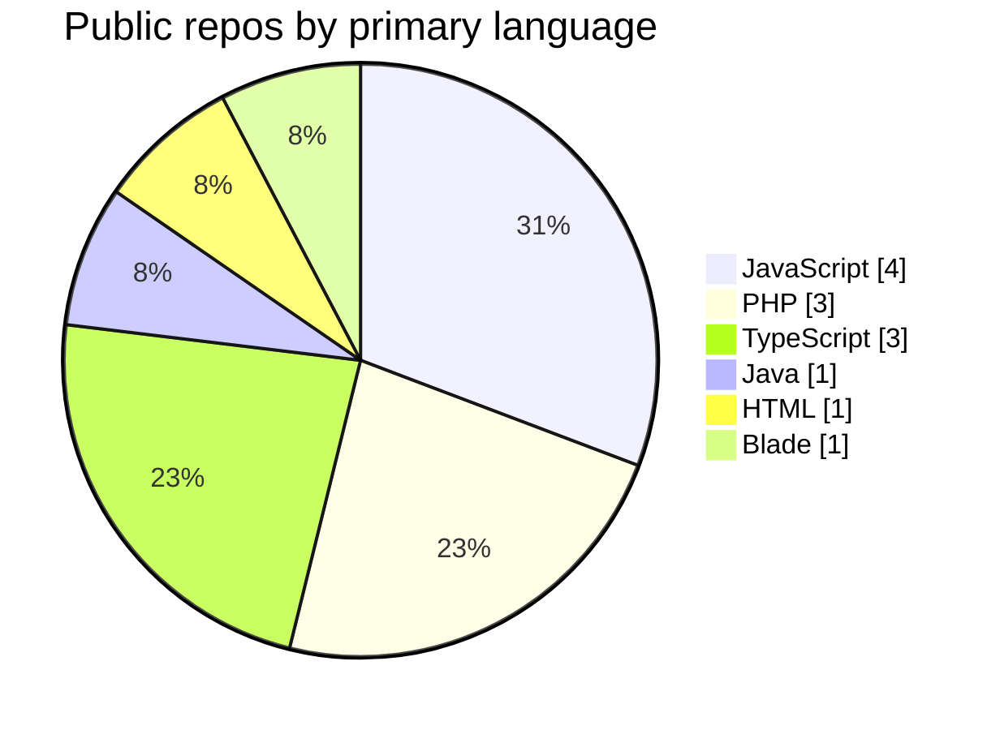

<!-- TODO: replace with your LinkedIn URL -->

<!-- TODO: replace with your email -->

---

## 👨‍💻 About Me

- 🎓 Third-year **IT undergraduate at SLIIT**
- 🏢 Building products at **[Aureus Technologies](https://www.aureustech.online)**
- 🔭 Looking for an **internship** to gain hands-on industry experience
- 🧩 Quick learner with strong problem-solving skills
- 📍 Based in **Sri Lanka**

## 🛠️ Tech Stack

  

## 📊 Skills Proficiency

<!-- TODO: adjust the percentages to match your real comfort level -->

## 📈 GitHub Stats

  
  

  

## 🗓️ Contribution Activity

  

  <picture>
    <source media="(prefers-color-scheme: dark)" srcset="https://raw.githubusercontent.com/evanmunasinghe/evanmunasinghe/output/github-snake-dark.svg" />
    
  </picture>

## 🚀 Featured Projects

  
  
  
  
  
  

### 📦 Project Language Mix

---

### 🤝 Let's connect — open to internship opportunities!

